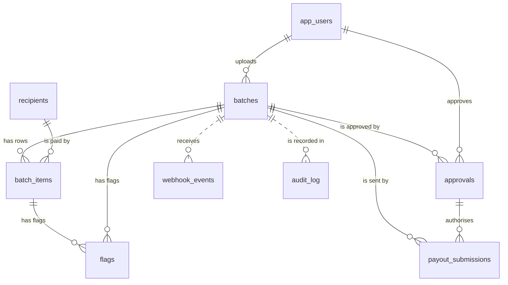
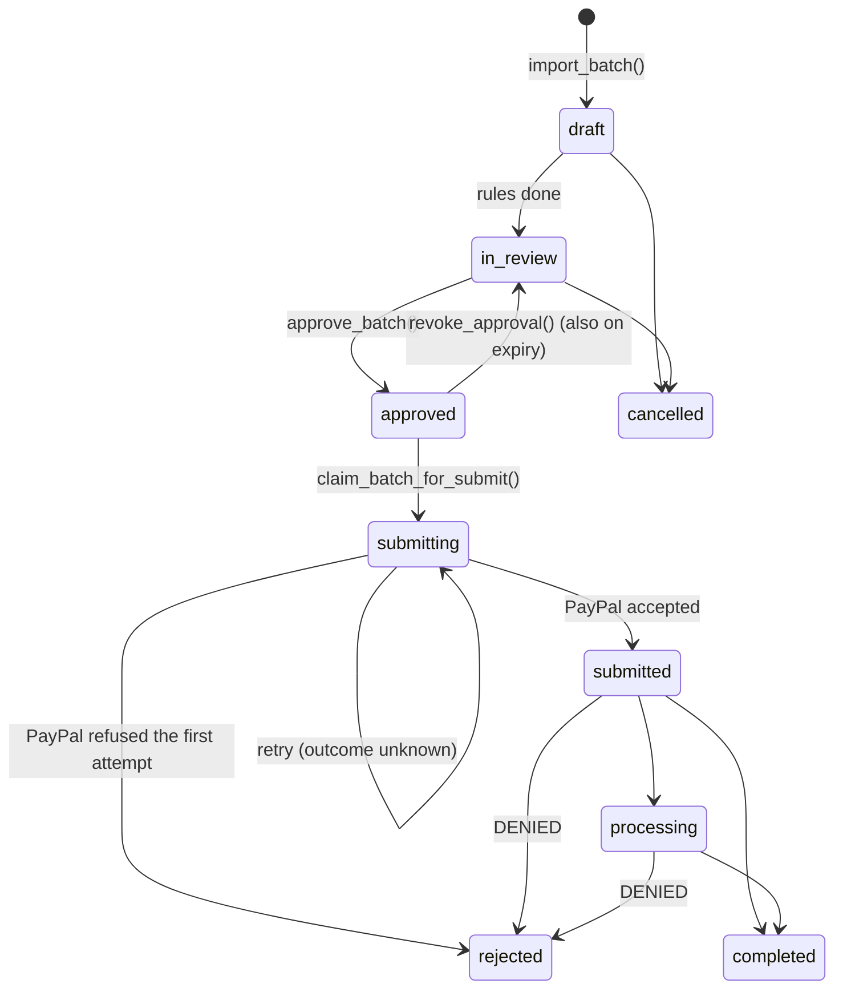

# Database design

Supabase Postgres, created by [backend/db/migrations/0001_initial_schema.sql](../backend/db/migrations/0001_initial_schema.sql) and tested by [backend/db/tests/test_schema.sql](../backend/db/tests/test_schema.sql).

The design follows one rule: **the AI prepares and explains; fixed rules and a human approval decide whether money moves.** The database enforces the parts of that rule that must hold even if application code has a bug.

## Tables



| Table | One row is | Notes |
|---|---|---|
| `app_users` | The demo admin or the approver | Passwords stay in `backend/.env`; this gives them stable ids. |
| `recipients` | A contractor in the directory | Unique on `(receiver_type, receiver)`. `vetting_status`: approved, pending or blocked. Imports add unknown emails as pending. |
| `batches` | One uploaded CSV | `sender_batch_id` is set at creation and can never change. Holds the column mapping, import problems, AI summary and PayPal batch status. |
| `batch_items` | One CSV row | Bad rows are stored too (with `raw`), so they can be flagged and shown. `decision` is pending, include or exclude. `committed_at` locks the row once approved. The row id is PayPal's `sender_item_id`. |
| `flags` | One rule result | Written by the rules engine. The AI may only add `ai_explanation`. A flag with no `batch_item_id` is about the whole batch. |
| `approvals` | One approval | Snapshot of the count, total and `sender_batch_id` that the approver saw, plus an HMAC signature made by the API. Immutable; it can only be consumed or revoked. |
| `payout_submissions` | One call to PayPal | Outcome is in_flight, accepted, rejected or unknown. Only one attempt can be in flight per batch. |
| `webhook_events` | One verified PayPal webhook | Unique on PayPal's event id, so a redelivery is a no-op. |
| `audit_log` | One event | Append-only and hash-chained. Written by triggers, so no code path can skip it. |

Read models: `batch_item_overview` (each row with its flag codes, worst severity, vetting status and reconciliation bucket, for the AG Grid) and `batch_overview` (per-batch totals and the paid / pending / failed / flagged counts).

## Batch lifecycle



A trigger refuses any other transition. `approved`, `submitting` and `submitted` also require their evidence row (a live approval, an in-flight attempt, an accepted attempt), so a bare `UPDATE batches SET status = ...` cannot fake them.

## Guarantees and where they are enforced

| Guarantee | Enforced by |
|---|---|
| A retry can never pay twice | `sender_batch_id` is immutable (trigger). Every attempt sends it, and PayPal refuses a second batch with the same id; the sandbox answers `USER_BUSINESS_ERROR` with a link to the existing batch, which the API uses to record the attempt as accepted. One attempt in flight per batch (partial unique index). |
| No invoice is paid twice to the same person | `approve_batch()` checks, and the partial unique index `batch_items_invoice_paid_once` is the backstop across all batches. A failed payout releases the invoice, so it can be retried in a new batch. |
| Submit needs a valid approval | `claim_batch_for_submit()` needs a live, unexpired approval whose count and total match the locked rows; the API also checks its HMAC signature first. |
| Rows cannot change after approval | Trigger on `batch_items`: while `committed_at` is set, payment fields and the decision are frozen. Revoking releases them. |
| Blocked rows cannot be paid | Trigger refuses `decision = include` on a row with a blocking flag; `approve_batch()` re-checks. |
| The uploader cannot approve their own batch | `approve_batch()`. |
| The approver approved what they saw | `approve_batch()` takes the count and total shown on screen and refuses if the batch changed since. |
| Out-of-order webhooks are harmless | `apply_item_statuses()` ignores events older than the stored `payout_status_at`; `apply_batch_status()` never moves a batch backwards. |
| Every flag, decision, approval, submission and status change is logged | `AFTER` triggers on each table write to `audit_log`. |
| The audit log is tamper-evident | `UPDATE`, `DELETE` and `TRUNCATE` raise; each row's `hash` covers the previous row's hash; `verify_audit_chain()` replays it. |
| The browser cannot read the database | RLS on every table with no policies, and grants revoked from `anon` and `authenticated`. The API uses the service-role key. |

## Functions the API calls

The Supabase Python client has no transactions, so every multi-step write is one Postgres function called with `supabase.rpc()`:

| Function | Called by | Does |
|---|---|---|
| `import_context(type, receivers[])` | importer | Directory entries and already-paid invoices for the rules engine. |
| `import_batch(created_by, batch, recipients, items, flags)` | importer | New recipients, the batch, its rows, flags and default decisions, in one transaction. |
| `set_item_decisions(batch, user, decisions)` | review screen | A person includes or excludes rows. |
| `approve_batch(...)` | approval step | The gate described above. |
| `revoke_approval(approval, reason, user)` | approval step, worker | Back to review and release the rows. |
| `claim_batch_for_submit(batch, approval, user)` | submit | Opens one attempt or refuses. |
| `record_submission_result(...)` | submit | Records PayPal's answer and moves the batch. |
| `apply_item_statuses(updates, source)` | webhook, poller | Applies item statuses, newest wins. |
| `apply_batch_status(payout_batch_id, status)` | webhook, poller | Maps PayPal's batch status. |
| `write_audit(...)` | API | Events no table change captures (refused submits, rejected webhooks, agent tool calls). |
| `verify_audit_chain()` | audit view | Checks the hash chain. |

## The approval signature

The API signs `paypap.approval.v1|approval_id|batch_id|sender_batch_id|approver_id|item_count|total|currency|expires_at` with HMAC-SHA256 and `APPROVAL_SIGNING_SECRET` ([backend/app/approvals.py](../backend/app/approvals.py)). The database stores it but cannot check it, because it never sees the secret. Submit recomputes it, so a row inserted or edited by hand, even with the service-role key, cannot release money.

## Applying and testing

```powershell
# This PC has no IPv6, so use the session pooler host (Supabase > Connect > Session pooler)
psql "postgresql://postgres.<ref>:<password>@aws-0-eu-west-1.pooler.supabase.com:5432/postgres" -v ON_ERROR_STOP=1 -f backend/db/migrations/0001_initial_schema.sql
# Runs every guarantee above inside one transaction and rolls it back: safe on any database
psql "<same url>" -f backend/db/tests/test_schema.sql
```

Applied to the project's Supabase database on 2026-10-24; the test file passed there and on a local Postgres 17.
